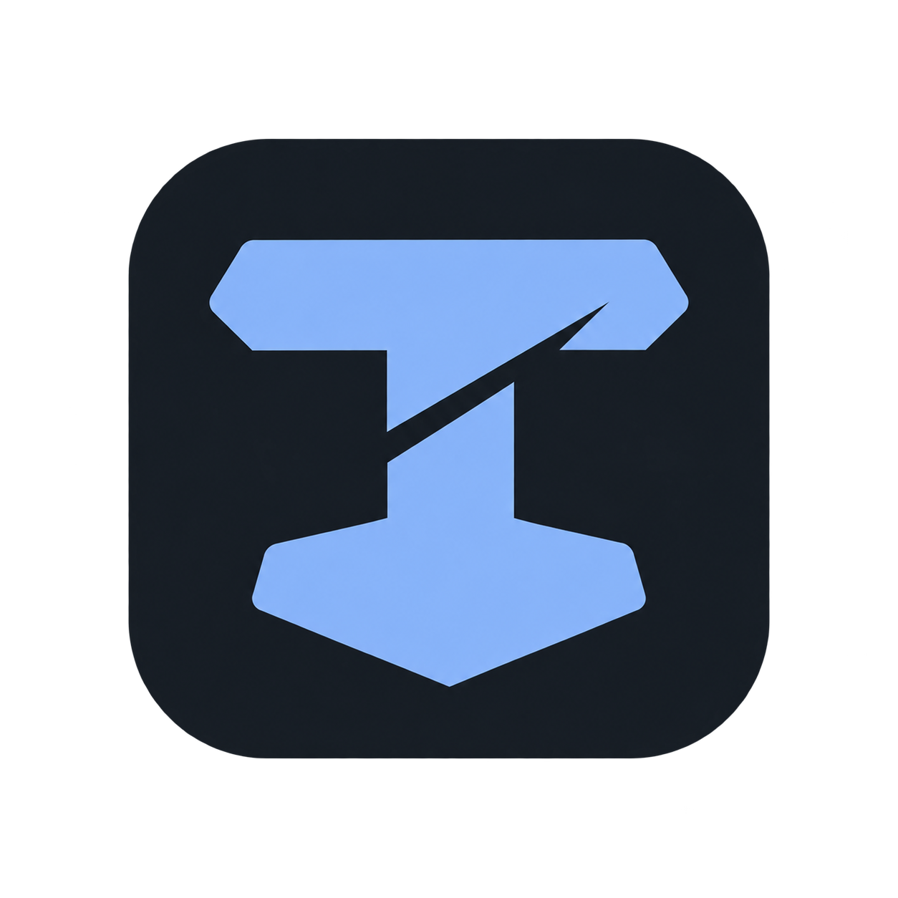

# Thor

Thor is a **macOS-only developer browser**. It combines a native Rust window, a tabless browsing interface, and developer tools that work alongside your pages. Thor embeds the pinned, stock, prebuilt Chromium Embedded Framework (CEF). It does not build or patch Chromium or launch system Chrome as its product browser. There are no plans to ship Thor for Linux or Windows.

## Browse and work

Use **Cmd+K** to find open pages, history for the current page, and saved bookmarks. Use **Cmd+Shift+K** to find a developer tool by task, or open the Developer Control Center. You can paste an HTTP or HTTPS URL into the address bar, including a localhost URL.

| Shortcut | Action |
|---|---|
| Cmd+K | Open Sites |
| Cmd+Shift+K | Open Toolbox |
| Cmd+L | Focus the address bar |
| Cmd+T / Cmd+W | Open / close a page |
| Control+Tab / Control+Shift+Tab | Switch to the next / previous open page |
| Cmd+R | Reload the current page |
| Cmd+Option+I | Open the developer tools for the current page |

The API workbench can send requests, inspect responses, and save requests to a project. Security analyzers accept supplied evidence for local analysis without sending target requests. The Developer Control Center exposes the registered Rust feature catalog and indicates the input each tool needs. Not every engine has a complete workflow in the browser yet.

## Open pages and saved work

- **Expiry today:** An unpinned page can close after 30 minutes in the background. Bringing it forward resets the timer. Detectable unsaved edits, active calls, and playback defer expiry; routine polling does not. Back and Forward are scoped to each open page.
- **Pinning ([#7](https://github.com/nirmalhk7/thor/issues/7)):** Pin or unpin an open page from Sites. Pinned pages do not expire automatically. Unpinning a background page gives it a fresh 30 minutes. Pins appear ahead of other open pages, which are ordered by recent use.
- **Recovery ([#9](https://github.com/nirmalhk7/thor/issues/9)):** Recovery after quit or crash restores only surviving open-page URLs in their original identities, with pins and expiry timing intact. Time while Thor is closed counts toward a background deadline. Closed and expired pages stay gone. This is not a browsing-history archive.

Pinning and recovery are tracked separately from the shipped expiry behavior. Closing a page removes its page-scoped history and unsaved captures. Saved project requests and explicitly saved artifacts are independent of pages; the current workbench does not yet expose saving for every tool result.

CEF request contexts separate each identity’s site storage, such as cookies and sign-in state. Site storage is distinct from browsing history and page recovery. Thor uses the macOS Keychain service **Thor Safe Storage** and account **Thor**. Cookies encrypted with the previous shared Chromium key may require signing in again.

## Seven developer disciplines

Thor’s product scope covers **Frontend, Backend, QA, Security, Performance, AI, and Web3**. The 144-entry FeatureEngine registry currently covers six of those disciplines; Web3 has a separate decoder module. Engine availability is not a claim that all seven workflows ship end to end.

- **Frontend:** Inspect a page’s runtime, DOM, and styling.
- **Backend:** Send HTTP requests and keep reusable reproductions.
- **QA:** Turn reproducible interactions into tests.
- **Security:** Review authorized, local or supplied evidence.
- **Performance:** Measure page behavior and inspect the results without guessing.
- **AI:** Inspect or evaluate model interactions.
- **Web3:** Decode and inspect Web3 RPC evidence.

No comparative performance claim is made without a published, same-Mac benchmark. Thor adds no product telemetry of its own; this is separate from stock CEF or website traffic and is tracked for verification in [#25](https://github.com/nirmalhk7/thor/issues/25).

## Build on macOS

Requirements: macOS, stable Rust, CMake, and Ninja. The Rust CEF dependency resolves the pinned prebuilt stock distribution. No Chromium checkout is needed.

```bash
# Build the app and helpers into a local macOS bundle.
cargo build --locked --release --features cef-bundle --bin Thor --bin thor-labs --bin thor-package
cargo run --locked --release --features cef-bundle --bin thor-package -- dist/cef
open dist/cef/Thor.app

# Run repository checks.
make check-structure
cargo check --locked --workspace --all-targets
cargo test --locked --workspace -- --test-threads=1
```

See [architecture](docs/ARCHITECTURE.md), the [feature catalog](docs/FEATURES.md), the [testing guide](docs/TESTING_GUIDE.md), and [contributor guidance](AGENTS.md).
