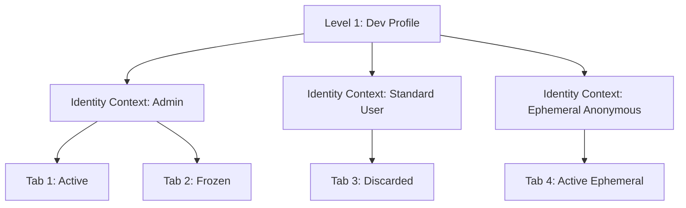
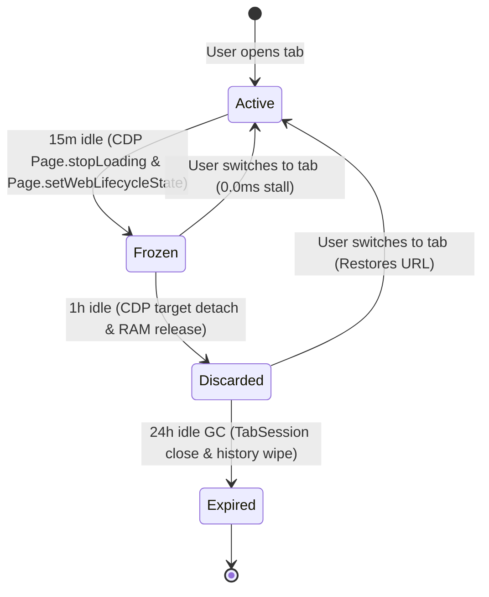

# Thor System Architecture & Operating Manual

## Overview

**Thor** is a high-performance, ephemeral developer browser designed for full-stack engineers, security specialists, performance auditors, AI/LLM developers, and Web3 builders. Thor prioritizes ultra-low weight, microsecond latency, and deep developer instrumentation over consumer feature bloat.

> **Core Positioning:**  
> *"A high-performance, ephemeral developer browser where every tab is an isolated experiment and every interaction can become a test, trace, benchmark, finding, or reproducible artifact."*

---

## Architectural Principles

1. **Chromium Internals for Semantics**: Native Chromium tab target management via Chrome DevTools Protocol (CDP) for modern web compatibility and Web Vitals observation.
2. **CDP for Developer Instrumentation**: Zero-friction network interception, DOM querying, layout vector rendering, and metrics collection.
3. **Rust for Orchestration**: High-concurrency event indexing, lock-free metrics aggregation, polyglot test generation, and protocol load generation.
4. **Zero Stub/Fake UI**: Every UI element in Thor is backed by real Rust state in `AppState::global()` — no simulated RNG or fake metrics. Offline-only Feature Suite tools are labeled **Analyzer (offline)**; live labs are consent-gated.
5. **Engineer Feature Suite**: Process-wide `FeatureEngine` (144 IDs) + `FeatureOrchestrator` IPC from Developer Control Center (`Cmd+⇧K`).

---

## 3-Level Isolation Hierarchy

Thor enforces strict memory and state separation across three distinct isolation tiers:

### Level 1: Profile Level
- **Scope**: Global developer settings, bookmarks database (`~/.gemini/antigravity/thor/bookmarks.json`), root CA certificates (`Thor Dev CA`), and IDE bridge registration (`vscode://`, `cursor://`).
- **Persistence**: Persistent across browser sessions. Zero global browsing history DB.

### Level 2: Identity Context Level
- **Scope**: Isolated `cookies`, `localStorage`, `IndexedDB`, `ServiceWorkers`, and authentication tokens (`Admin`, `Standard User`, `Anonymous`).
- **Isolation**: Prevents cross-context session contamination. Enables multi-role IDOR matrix testing across different identity contexts within the same browser session.
- **Lifecycle**: Disposable tabs purge ephemeral identity context immediately on close.

### Level 3: Tab Level
- **Scope**: Tab-scoped history list, scroll position, trace buffer, CDP event targets, and layout overlays.
- **Lifecycle**: Strictly tab-scoped. Wiped clean automatically on tab closure or 24-hour Garbage Collection.

---

## 4-Stage Ephemeral Tab Lifecycle

To ensure Thor remains significantly lighter than Google Chrome and Firefox, tabs progress through four automated lifecycle stages:

1. **Active (0 – 15m foreground)**:
   - Full render loop and CDP observation active. RAM footprint ~42.5 MB.
2. **Frozen (15m – 1h idle)**:
   - CDP `Page.stopLoading` and `Page.setWebLifecycleState(Frozen)`.
   - Halts JS timers and rendering while preserving DOM state. Zero process stall (0.0ms resume latency). RAM footprint reduced to ~8.2 MB.
3. **Discarded (1h – 24h idle)**:
   - CDP target detach and memory release. Preserves tab title, URL, and scroll position. RAM footprint < 0.5 MB.
4. **Expired ($\ge$ 24h auto-close)**:
   - Automatic close and complete wipe of tab-scoped history and trace buffers.

---

## Process & Runtime Architecture

Thor supports dual execution runtime models:

1. **Headful Chromium Process Mode (`chromium_shell::run_chromium_shell`)**:
   - Spawns single Chromium process for page content.
   - AppKit/tao window loop renders Thor's native developer toolbar, command palette (`Cmd+K`), and specialist toolbox (`Cmd+Shift+K`).
   - Managed via `shell/chromium_tabs.rs` and `engine/chromium_runtime.rs`.
2. **Wry WebKit Shell Mode (`run_wry_shell`)**:
   - Fallback mode enabled when `THOR_DUAL_WINDOW` environment variable is unset or set to `0`.

---

## Subsystem Map

- **`src/main.rs`**: Entry point (mimalloc allocator + Tokio multi-thread runtime + shell runner).
- **`src/lib.rs`**: Library crate `thor`.
- **`src/app_state.rs`**: Global thread-safe singleton state (`AppState::global()`), including `FeatureEngine` + `EngineHandle`.
- **`src/engine/`**: Chromium runtime launcher, CDP tab session manager, prewarm pool, lifecycle freezer (Instant-timed freeze samples), and `TabEvalHandle` for DevCC `from_active_tab`.
- **`src/shell/`**: Native AppKit toolbar, chrome UI HTML/JS renderer (`gui.rs` Developer Control Center), and IPC dispatch (`feature_list` / `feature_invoke` / `lens_payload`).
- **`src/features/`**: Engineer Feature Suite — **144** `FeatureId`s across Frontend / Backend / Security / Performance / QA / AI; `FeatureOrchestrator`, CDP bridge, and feature-path SLAs.
- **`src/dx/`**: Command palette (`Cmd+K`), CSS layout overlay, LLM studio, clean context builder (`Cmd+Shift+C`), Web3 inspector, polyglot test generator (Promote to Test + CI compose), and IDE bridge.
- **`src/net/`**: Security shield, IDOR matrix scanner, traffic tamper engine, SSL CA generator, Locust load testing proxy, and lab consent / abuse-target gates.
- **`src/mcp/`**: Model Context Protocol (MCP) server (`server.rs`) and 8 browser automation tools (`tools.rs`).
- **`src/load/`**: Thor load engine, scenario compiler, lock-free atomic metrics (SoftNav + transfer bytes), browser Web Vitals runner, and Rust protocol scale runner.
